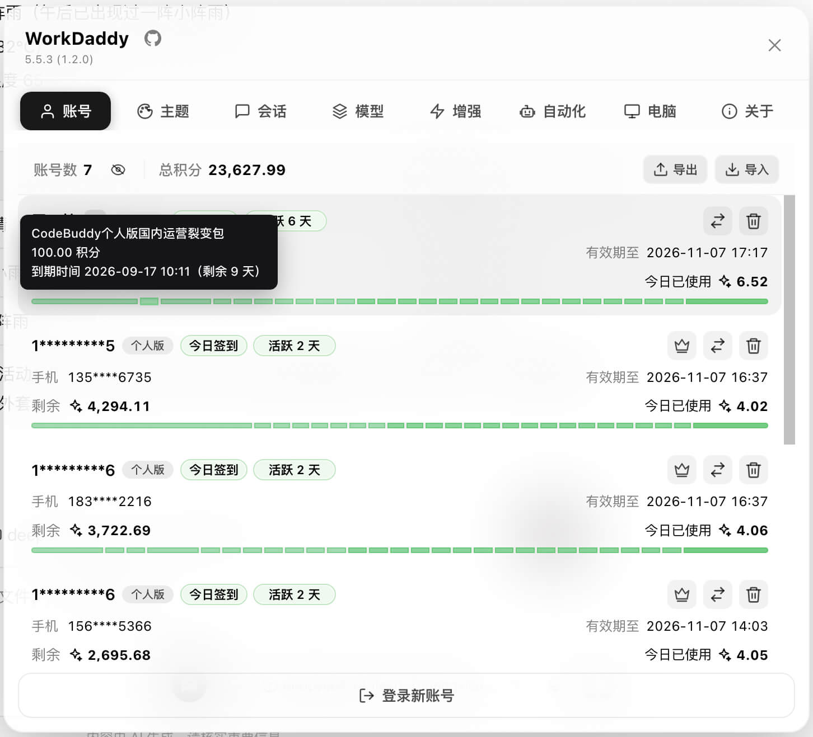
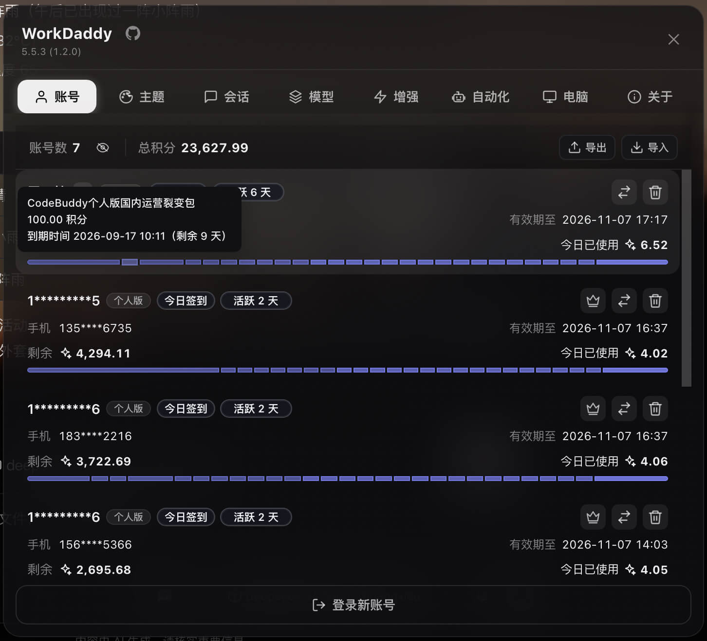
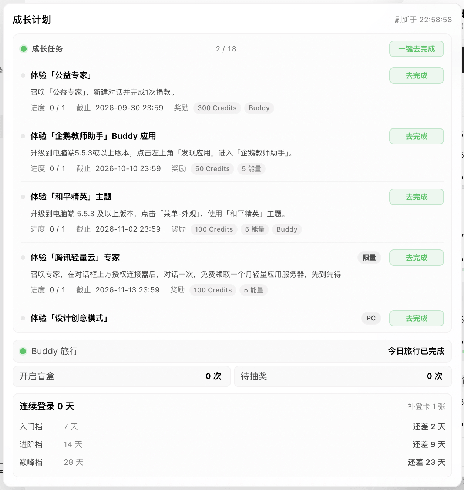
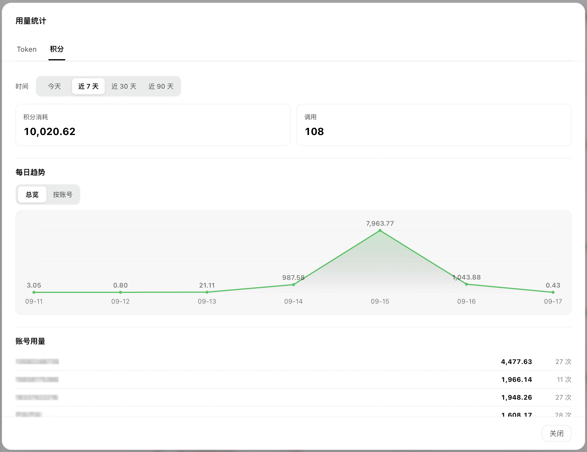
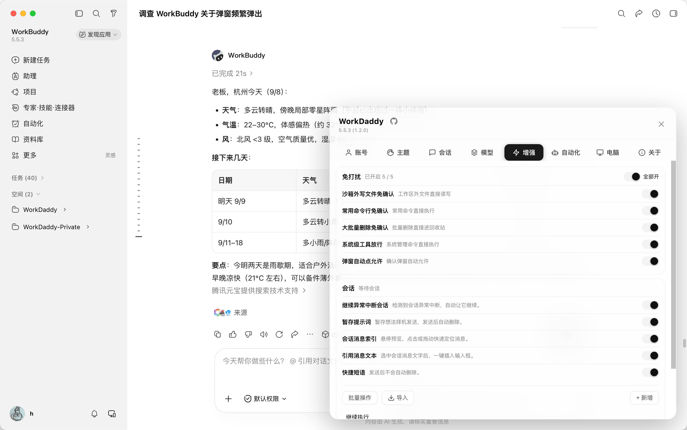
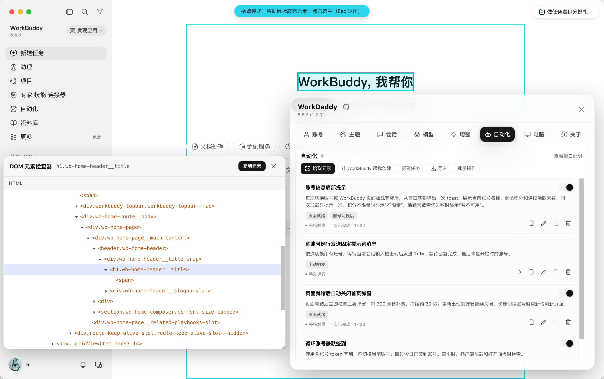
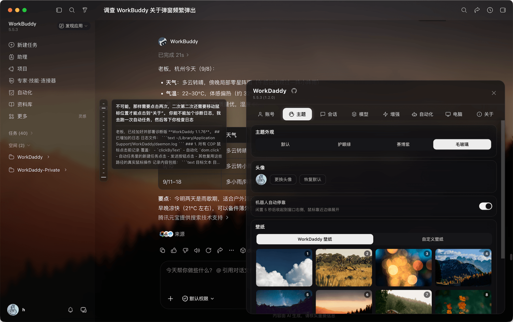

<h1>  WorkDaddy</h1>

**言語：** [简体中文](README.md) · [English](README_en.md) · [日本語](README_ja.md)

> **WorkDaddy / CodeDaddy は、WorkBuddy と CodeBuddy のデスクトップクライアントに、アカウントごとのバックアップ、アカウントの切り替え、セッションの移行、モデルの管理、オートメーションを追加します。WorkBuddy では、静かな承認、自動継続、プロンプトの退避、定型文、5 種類のテーマにも対応しています。アカウントと設定はあなたのコンピューターの中にとどまります。**
> ローカルのループバックでの CDP インジェクション · 公式のインストールが変更されることはありません。

**Chrome DevTools Protocol（CDP）** をもとに作られた、[WorkBuddy](https://www.workbuddy.cn/)、[WorkBuddy AI](https://www.workbuddy.ai/)、[CodeBuddy CN](https://www.codebuddy.cn/)、[CodeBuddy](https://www.codebuddy.ai/) 向けのデスクトップの拡張ツールです。
CodeBuddy への対応は、VS Code のエディターのモードではなく、その **Electron のエージェントウィンドウ** を対象としています。ローカルのデバッグ用のインターフェースを使い、公式のインストールや署名を変更することなく、実行中のクライアントに接続します。


---

## クライアントと機能の範囲

| 公式のクライアント | パッケージのブランド | プロファイル |
| --- | --- | --- |
| WorkBuddy（中国本土版） | WorkDaddy | `workbuddy-cn` |
| WorkBuddy AI（国際版） | WorkDaddy AI | `workbuddy-ai` |
| CodeBuddy CN（中国本土版、Electron） | CodeDaddy CN | `codebuddy-cn` |
| CodeBuddy（国際版、Electron） | CodeDaddy | `codebuddy-intl` |

- 注：CodeBuddy では Enhance のページは表示されず、Theme のページではフローティングロボットの設定だけが提供されます。

## プレビュー












---

## できること

- **すばやいアカウントの切り替え：** クライアントごとにアカウントのバックアップを別々に保持するので、毎回 QR コードをスキャンすることなく切り替えられます。
- **終了せずにアカウントを追加：** WorkBuddy を開いたまま、ブラウザで OAuth による認可を行えます。新しいアカウントは自動的に一覧に追加されます。従来のソフトログアウトの手順も利用できます。
- **暗号化されたアカウントのインポート/エクスポート：** パスワードで保護されたファイルを使って、アカウントのバックアップをコンピューター間で移動できます。
- **成長とアクティビティ：** 中国本土版では、成長タスクの進捗、毎日のチェックインとアクティビティの状態、連続アクティブ日数、Buddy の解放と旅行の状態を表示します。
- **トークンとクレジットの使用量のページ：** 日ごとのトークンとクレジットの消費量を確認し、アカウントで絞り込み、モデルとアカウントごとの使用量のランキングを表示できます。
- **クレジットを考慮したアカウントの提案：** アカウントのクレジットが少なくなると、WorkDaddy が使える別のアカウントを提案します。
- **モデルのレート制限とリセットの見込み：** モデルのレート制限が検出されると、Accounts のページに、影響を受けるモデルとリセットの見込み時刻が表示されます。リセットの時刻が提供されない場合は、「Time unknown」と表示されます。
- **オートメーションのタスク：** 公開されている GitHub や Gitee のリポジトリからタスクを見つけてインポートしたり、必要なことを説明して WorkBuddy にタスクを作成させたりできます。手動、イベント、スケジュールのトリガー、実行ログ、タスクの停止、JSON / ZIP でのエクスポートに対応しています。
- **静かな承認のモード：** 席を離れている間、対応している権限の確認を自動的に処理します。
- **プロンプトの退避：** 画像、ファイル、引用を保ったまま、下書きを WorkBuddy の保留中のメッセージのキューに送り、あとで使えるようにします。
- **テーマ：** WorkBuddy の Manage のテーマの切り替えでは、システムに合わせる、ライト、ダーク、目に優しいグリーン、サイバーパープル、すりガラスを選べます。「システムに合わせる」は、OS のダーク/ライトのモードを追跡して自動的に切り替えます。すりガラスはプリセットとカスタムの壁紙に対応しており、管理をオフにすると、クライアント本来の見た目に戻ります。
- **セッションの移行：** アカウント間でセッションを自動または手動でコピーし、作業を中断したところから続けられます。
- **セッションの分岐：** Enhance で有効にすると、どの返答からも、その返答までのチャットを保った新しい会話を始められ、元の会話はそのまま残ります。
- **モデルのツール：** 同じモデル名の複数の設定を含め、モデルをより簡単に管理し、切り替えられます。
- **スリープの制御：** AI のタスクの実行中はコンピューターがスリープしないようにし、終わったら通常どおりスリープできるようにします。
- **自動継続：** ネットワークの不安定さ、タイムアウトなどの失敗で中断されたタスクを、自動的に続行します。
- **定型文：** よく使うプロンプトをパネルに保存し、入力欄のツールバーから送信できます。

---

## インストール

先に公式のクライアントをインストールしてサインインし、上の表から対応するパッケージのブランドを選んでください。4 つのパッケージは、それぞれ別々のインストールとアカウントのバックアップのディレクトリを持ちます。パッケージ名のスペースはハイフンで書かれています。

### macOS

1. [Releases](../../releases) から、お使いのクライアントに合った `WorkDaddy-x.y.z.dmg`、`WorkDaddy-AI-x.y.z.dmg`、`CodeDaddy-CN-x.y.z.dmg`、または `CodeDaddy-x.y.z.dmg` をダウンロードします。
2. DMG を開き、アプリを **アプリケーション** にドラッグします。
3. Apple がアプリに悪意のあるソフトウェアが含まれていないことを確認できない、と macOS に表示された場合：
   1. **システム設定 → プライバシーとセキュリティ** を開きます。
   2. ブロックされた WorkDaddy のアプリを見つけ、**このまま開く** を選びます。
   3. ログインのパスワードで確認します。
      
4. 対応する WorkDaddy / CodeDaddy のアプリを起動します。ローカルのデーモンが起動し、クライアントにパネルが注入されます。macOS のランチャーはローカルにインストールされた Node.js を使います。Node.js 22.13 以降をおすすめします。
5. ロボットのボタンが表示されたら、準備は完了です。

#### 企業向け / VPC のクライアント

macOS では、WorkDaddy は名前が `WorkBuddy` で始まり、`Contents/MacOS/Electron` を含むアプリ（`WorkBuddy企业定制版.app` など）を探します。候補は WorkDaddy または WorkDaddy AI のプロファイルで絞り込まれます。複数のクライアントが一致した場合は、システムの選択画面で 1 つを選べ、その選択が記憶されます。設定ファイルを手動で探す必要はありません。名前が完全にカスタマイズされたアプリの場合は、ソースのディレクトリから次の高度な設定のコマンドを実行してください：

```bash
node scripts/workbuddy-target.js --configure --platform darwin \
  --profile workbuddy-cn \
  --binary "/Applications/Enterprise Client.app/Contents/MacOS/Electron" \
  --data-dir "$HOME/Library/Application Support/WorkDaddy"
```

### Windows

1. [Releases](../../releases) から、お使いのクライアントに合った `WorkDaddy-Setup-x.y.z.exe`、`WorkDaddy-AI-Setup-x.y.z.exe`、`CodeDaddy-CN-Setup-x.y.z.exe`、または `CodeDaddy-Setup-x.y.z.exe` をダウンロードします。
2. インストーラーを実行します。
3. デスクトップのショートカットから、対応するブランドを起動します。

#### Windows のポータブル版の ZIP

対応する `<brand>-Portable-x.y.z.zip` を使ってください。`<brand>` は `WorkDaddy`、`WorkDaddy-AI`、`CodeDaddy-CN`、または `CodeDaddy` です。書き込み可能なディレクトリに展開し、`Start-WorkDaddy.cmd` または `WorkDaddyLauncher.exe` を実行します。新しい ZIP に置き換える前に、`Stop-WorkDaddy.cmd` を実行してください。

ポータブル版のパッケージは、ショートカットやアンインストールの項目を作成しません。バックアップは ZIP の中ではなく、現在のユーザーの `%APPDATA%\WorkDaddy` に残ります。同じプロファイルのインストール版とポータブル版を同時に実行しないでください。ポータブル版では、パネルのインストーラーによる更新は使えません。

#### 企業向け / VPC のクライアント

お使いのクライアントのインターフェースに最も近い、WorkDaddy または WorkDaddy AI の版をインストールしてください。インストーラーは対応する公式のクライアントを検出し、そのパスとバージョンを表示します。企業のユーザーは、**Browse** を選んで独自の `.exe` を選択できます。設定ファイルや環境変数を編集する必要はありません。

この選択は WorkDaddy の個人用のデータディレクトリに保存され、更新時にも保持されます。変更したり、検出された公式のクライアントに戻したりするには、インストーラーを再度実行してください。WorkDaddy は選択したクライアントのバージョンを固定するので、クライアントをアップグレードしたり移動したりしたあとは、インストーラーを使ってクライアントを再度確認してください。

### Linux

Ubuntu / Debian 向けのパッケージが `amd64` と `arm64` で提供されており、対応する Node.js のランタイムが同梱されています。先に、同じアーキテクチャの公式のクライアントをインストールしてサインインしてください。

| ブランド | DEB ファイル | インストールのディレクトリ / Debian のパッケージ名 |
| --- | --- | --- |
| WorkDaddy | `WorkDaddy_x.y.z_<arch>.deb` | `/opt/workdaddy` / `workdaddy` |
| WorkDaddy AI | `WorkDaddy-AI_x.y.z_<arch>.deb` | `/opt/workdaddy-ai` / `workdaddy-ai` |
| CodeDaddy CN | `CodeDaddy-CN_x.y.z_<arch>.deb` | `/opt/codedaddy-cn` / `codedaddy-cn` |
| CodeDaddy | `CodeDaddy_x.y.z_<arch>.deb` | `/opt/codedaddy` / `codedaddy` |

1. [Releases](../../releases) から対応するファイルをダウンロードします。`<arch>` には `amd64` または `arm64` を選びます。
2. ダウンロードしたディレクトリからインストールします。例：

   ```bash
   sudo apt install ./CodeDaddy-CN_1.2.9_amd64.deb
   ```

3. アプリケーションのメニューから対応するブランドを起動し、指示に従って CDP を有効にします。CodeBuddy の場合は、その Electron のエージェントウィンドウを開きます。

4 つのパッケージは共存でき、デフォルトではログイン時の自動起動は有効になりません。アプリケーションのメニューがない場合は、対応するエントリーポイントを使ってください：

```bash
bash /opt/workdaddy/scripts/launch-gui-linux.sh cn
bash /opt/workdaddy-ai/scripts/launch-gui-linux.sh ai
bash /opt/codedaddy-cn/scripts/launch-gui-linux.sh codebuddy-cn
bash /opt/codedaddy/scripts/launch-gui-linux.sh codebuddy-intl
```

必要に応じて、プロファイルの systemd のユーザーサービスを有効にします。例：

```bash
WBSWITCH_PROFILE=codebuddy-cn bash /opt/codedaddy-cn/scripts/systemd-install-linux.sh
```

アンインストールするには `sudo apt remove <package-name>` を使います。`~/.config/WorkDaddy` の下のアカウントのバックアップと実行時のデータは保持されます。Linux では現在、パネルからの更新に対応していません。アップグレードするには、新しい DEB をインストールしてください。

Linux でソースからインストールする場合は、適切な `WBSWITCH_PROFILE` を指定して、`scripts/install-linux.sh` と `scripts/relaunch-with-cdp-linux.sh` を使ってください。WorkBuddy AI では、独立した環境のために `scripts/workbuddy-ai-linux.sh install` と `scripts/workbuddy-ai-linux.sh relaunch` を使えます。クライアントの実行ファイルを明示的に選ぶ必要がある場合は、`WBSWITCH_WORKBUDDY_BIN=/path/to/client` を設定してください。

### ソースから実行する（開発者向け）

```bash
git clone https://github.com/babygoton/WorkDaddy.git
cd WorkDaddy
bash scripts/install.sh           # Create the backup directory and start the daemon
bash scripts/relaunch-with-cdp.sh  # Launch WorkBuddy with CDP on port 9222
```

4 つのクライアントはすべて、同じデーモンのコードを共有しています。プロファイルは、最初に見つかった CDP のポートから推測するのではなく、デーモンを目的のクライアントに結び付けます：

```bash
WBSWITCH_PROFILE=workbuddy-cn bash scripts/relaunch-with-cdp.sh
WBSWITCH_PROFILE=workbuddy-ai bash scripts/relaunch-with-cdp.sh
WBSWITCH_PROFILE=codebuddy-cn bash scripts/relaunch-with-cdp.sh
WBSWITCH_PROFILE=codebuddy-intl bash scripts/relaunch-with-cdp.sh
```

リリースのスクリプトは、macOS 向けに 4 つの DMG、Linux 向けにアーキテクチャごとに 4 つの DEB、Windows 向けにクライアントごとに Setup.exe とポータブル版の ZIP をビルドします。ダウンロードできるものは、各 [Release](../../releases) に添付されたアセットによって異なります。

```bash
WORKDADDY_BUILD_VERSION=1.2.9 bash scripts/build-mac-dmg.sh
WORKDADDY_BUILD_VERSION=1.2.9 WORKDADDY_BUILD_ARCH=amd64 bash scripts/build-linux-deb.sh
WORKDADDY_BUILD_VERSION=1.2.9 WORKDADDY_BUILD_ARCH=arm64 bash scripts/build-linux-deb.sh
```

macOS では、上の表の任意のプロファイルを `WORKDADDY_BUILD_PROFILE` に指定すると、1 つのクライアントだけをビルドできます。Windows のポータブル版の ZIP はそのまま使えるリリースのダウンロードで、`*-win64.zip` のファイルはインストーラーのビルド用の一時的な入力です。

`install.sh`：

- `~/Library/Application Support/WorkDaddy` にバックアップのディレクトリを作成します。
- 初回起動時に、古いディレクトリを残したまま、`~/Library/Application Support/HelloBuddy/accounts` から旧来のバックアップを移行します。
- 現在サインインしている WorkBuddy のアカウントをバックアップします。
- 古い launchd の登録を削除し、デーモンを手動で起動します。ログイン時に自動で起動することはなくなりました。
- バックグラウンドのデーモンをすぐに起動します。
- `http://127.0.0.1:47832` で管理画面を開きます。

> インストーラーはデーモンを一度だけ起動します。その後は、必要なときに適切な WorkDaddy のアプリを起動してください。

---

## 仕組み

**CDP インジェクション · 公式のインストールが変更されることはありません**

```text
┌─────────────┐  --remote-debugging-port=9222  ┌──────────────┐
│  WorkBuddy  │ <───────────────────────────> │  WorkDaddy   │
│  (Electron) │       Chrome DevTools         │  daemon.js   │
│             │       Protocol (CDP)         │              │
│  Renderer   │  ←── Runtime.evaluate ────    │  HTTP :47832 │
│  Bottom     │      inject.js               │  Local API   │
│  right      │                              │              │
└─────────────┘                              └──────────────┘
```

この図は、中国本土版の WorkBuddy を例にしています。上に示したプロファイルの順に、ローカルの API のポートのデフォルトは `47832`、`47833`、`47834`、`47835` で、レンダラーの CDP のポートのデフォルトは `9222`、`9223`、`9224`、`9225` です。CodeBuddy では、ネイティブの認証とセッションの保存のために、ローカルのメインプロセスのデバッグ用のポート `9244` / `9245` も使います。

1. **変更されない WorkBuddy のバイナリ：** ランチャーは WorkBuddy を起動するときに `--remote-debugging-port=9222` を追加します。バイナリと署名はそのままです。
2. **CDP の接続：** デーモンはログインと認証のネットワークのイベントを監視し、フォールバックとしてファイルの監視も行います。ログインとトークンの更新のイベントでは、`account.uid` を使って、現在のアカウントを安定したローカルのディレクトリにバックアップします。
3. **注入される UI：** `Runtime.evaluate` がレンダラーで `inject.js` を実行し、クライアントの機能に応じて、ロボットのボタンと、Accounts、Theme、Sessions、Models、Enhance、Automation、Computer、About、Settings の各ページを追加します。CodeBuddy では Enhance は非表示になります。
4. **ローカルの HTTP API：** デーモンは `127.0.0.1:47832` で待ち受けます。パネルは、アカウントの切り替え、テーマ、チェックイン、権限の確認、スリープの制御などの機能にこれを使います。
5. **データの境界：** アカウントのバックアップと設定はローカルにとどまります。ログインとクレジットの機能は対応するクライアントの公式の API を呼び出し、更新の確認は GitHub Releases を呼び出します。明示的に行うモデルの接続テストでは、設定したモデルのサービスに、リクエストと対応する API キーを送信します。伏せ字にしたエラーの診断情報はデフォルトで有効になっており、**About** でオフにできます。

> なぜ公式のプラグインの仕組みではなく CDP なのか？CDP は実行中のアプリに直接接続し、認証の変化を検出し、パネルとスタイルのパッチを注入できるからです。WorkBuddy のインターフェースが大きく変わらない限り、WorkBuddy の更新とは一般に互換性が保たれます。

---

## 使い方

### パネル

WorkBuddy または CodeBuddy の Electron のウィンドウの右下にあるロボットのボタンをクリックし、タブを選びます：

| タブ            | 用途                                                                                                                                   |
| -------------- | ----------------------------------------------------------------------------------------------------------------------------------------- |
| **Accounts**   | アカウント数、クレジット、モデルのレート制限とリセットの見込み時刻、毎日のチェックインの状態、連続アクティブ日数、成長の進捗、Buddy の旅行の状態を表示します。アカウントの切り替え、削除、追加、暗号化されたバックアップのインポート/エクスポートを行えます               |
| **Theme**      | WorkBuddy：6 種類のテーマ（システムに合わせるを含む）、壁紙、アバター、ぼかし、オーバーレイを管理します。CodeBuddy：黒または白のフローティングロボットの設定     |
| **Sessions**   | アカウントと日付で絞り込み、一括でコピーまたは削除し、アカウントを切り替えるときのセッションやワークスペースの自動コピーを設定します          |
| **Models**     | バックアップ、コピー、編集、有効化、接続テスト、一括削除を含め、現在のモデルと代替のモデルを管理します               |
| **Enhance**    | 静かな承認、自動継続、セッションの分岐、プロンプトの退避、定型文を設定します                                                              |
| **Automation** | 公開されているリポジトリからタスクを見つけてインポートし、タスクを作成・管理し、イベントやスケジュールのトリガーを設定し、実行ログを確認し、実行中のタスクを停止し、JSON や ZIP のファイルをエクスポートします |
| **Computer**   | スリープを許可または禁止するか、すべての AI のタスクが終わったあとに通常のスリープに戻します                                                                 |
| **About**      | バージョンとプロジェクトの情報を表示し、更新を確認してインストールし、伏せ字にしたエラーの診断情報を制御します                               |
| **Settings**   | 中国語か英語を選びます。初回起動時はシステムの言語に従い、それ以外の場合は英語になります                                         |

**入力欄のツール（WorkBuddy / WorkBuddy AI のみ）：** 入力欄のツールバーのボタンを表示するには、**Enhance** で **Stash prompts** と **Quick phrases** をそれぞれ有効にします。退避すると、テキスト、画像、ファイル、引用を **保ったまま**、現在の下書きが WorkBuddy 自身のメッセージのキューに追加され、自動送信が一時停止されます。その後、入力欄は空になります。キューに入った内容は会話ごとに保持され、送信、編集、削除ができます。定型文は Enhance で作成、編集、一括管理し、入力欄のツールバーから送信できます。送信しても定型文は削除されません。

### オートメーション

繰り返しの操作をタスクとして保存できます：毎日のチェックイン、アカウントのクレジットの照会、条件付きのリマインダー、特定の会話でメッセージを送って返信を待つ、といったものです。

1. **Automation** を開き、**Discover tasks** で公開されているリポジトリで公開されたタスクを閲覧するか、**Create with WorkBuddy** で必要なことを説明します。WorkBuddy は新しい会話でタスクを生成し、完了すると一覧に追加します。**New task** を使ってステップの JSON を自分で編集することもでき、**View capabilities** には現在対応している操作が一覧表示されます。
2. トリガーを選びます：手動で実行するか、クライアントの読み込み、パネルを開いたとき、ページの準備ができたとき、アカウントの切り替えといったイベントに反応させます。スケジュールは、間隔、毎日、毎週、毎月、特定の日時に対応しています。
3. 一覧から、タスクの有効化、無効化、編集、コピーを行えます。手動のタスクはすぐに実行でき、イベントとスケジュールのタスクは設定に従って実行されます。必要に応じて実行中のタスクを停止し、**Run logs** で結果と失敗したステップを確認してください。

**インポートとエクスポート：** **Discover tasks** を通じて、公開されているリポジトリからタスクをインポートできます。インポートしたタスクは無効のままで、同じ ID の既存のタスクは上書きされず、互換性のないタスクにはその理由が表示されます。一括操作でタスクを選んでエクスポートします：1 つのタスクからは JSON ファイルが、複数のタスクからはバックアップや共有のための ZIP が作成されます。

タスクの定義はローカルに保存され、WorkDaddy のデーモンによって実行されます。スケジュールとイベントのトリガーには、デーモンが実行され続けている必要があります。ページを操作するステップには、対応する WorkBuddy のクライアントが利用できることも必要です。タスクのエクスポートには、アカウントのバックアップと実行ログは含まれません。Automation のページでは、ローカルの JSON や ZIP のファイルをインポートすることはできません。

#### 公開タスクを投稿する

**Discover tasks** には、公開されている GitHub と Gitee のリポジトリのタスクが一覧表示されます。推奨される構成については、[`babygoton/workdaddy-official-plugin`](https://github.com/babygoton/workdaddy-official-plugin) をご覧ください：

1. サンプルのリポジトリをクローンし、不要なサンプルのタスクを削除します。
2. タスクの JSON ファイルを `tasks/` ディレクトリに置きます（1 ファイルあたり最大 1 MiB、1 リポジトリあたり最大 200 タスク）。
3. GitHub または Gitee にコミットしてプッシュします。
4. リポジトリの説明に、キーワード `WorkDaddyAutomationRepository` を追加します。

この規約に従ったリポジトリは、次の更新のあとに **Discover tasks** に表示されます（検索結果は 10 分間キャッシュされます）。インポートではファイルを読み取って互換性のチェックを行うだけで、インポートしたタスクは無効のままになり、同じ ID の既存のタスクは上書きされません。

### アカウントを別のコンピューターに移す

Accounts のページの右上にある **Export** と **Import** を使います：

1. 古いコンピューターで WorkDaddy を開き、**Export** を選んで、生成された `WorkDaddy-账号导出-YYYY-MM-DD.json` ファイルを保存します。
2. そのファイルを新しいコンピューターに安全に転送し、そこで WorkDaddy をインストールして起動します。
3. Accounts のページで **Import** を選び、ファイルを選択します。復元されたアカウントが、アカウントの一覧に表示されます。

現在のエクスポートでは、あなたのパスワード、毎回新しく生成されるランダムなソルト、AES-256-GCM の暗号化を使います。パスワードはエクスポートに保存されません。暗号化されたファイルにも、ログインのセッションを復元できるトークンが含まれているので、パスワードと同じように保護し、移行後は不要なコピーを削除してください。旧来の v1 のエクスポートも引き続きインポートできます。

## セキュリティとプライバシー

- **ローカルのデータを優先：** アカウントのバックアップ、テーマ、ローカルの設定が、バックグラウンドでアップロードされることはありません。ログインとクレジットの機能は対応するクライアントの公式の API に、更新は GitHub Releases にアクセスします。明示的に行うモデルの接続テストでは、設定したサードパーティのモデルのサービスに、リクエストと対応する API キーを送信します。
- **エラーの診断情報はデフォルトで有効：** About の **Send error diagnostics** のスイッチは、リモートの Sentry へのエラー報告と、ローカルの伏せ字にしたレンダラーのログの両方を制御し、バージョンや互換性の問題の診断に役立てます。報告は伏せ字にされ、切り詰められます。リモートの報告には、アカウント、セッションの内容、トークン、API キーは含まれません。診断情報は About でいつでもオフにでき、起動時に明示的に上書きするには `WORKDADDY_TELEMETRY=0` / `1` を使います。

別途 `SECURITY.md` で、より詳しい脅威モデルを提供する場合があります。それが含まれていない場合は、このセクションがプライバシーとセキュリティの概要となります。

---

## ライセンスと免責事項

このプロジェクトは **[GNU Affero General Public License v3.0](LICENSE)**（`SPDX-License-Identifier: AGPL-3.0-or-later`）のもとでライセンスされています。

- WorkDaddy / CodeDaddy は、WorkBuddy と CodeBuddy のためのローカルの UI と使いやすさの拡張を提供するもので、**どちらの公式の製品とも提携していません**。
- WorkBuddy、CodeBuddy、それらの商標、公式のアセットは、それぞれの所有者に帰属します。このプロジェクトは、どちらの製品からも公式に認可や支持を受けていません。
- サードパーティのテーマ、壁紙、背景画像はデモンストレーションのために提供しています。商用利用の前に、その権利を確認してください。

---

## Star History

<a href="https://www.star-history.com/?repos=babygoton%2Fworkdaddy&type=date&legend=top-left">
 <picture>
   <source media="(prefers-color-scheme: dark)" srcset="https://api.star-history.com/chart?repos=babygoton/workdaddy&type=date&theme=dark&legend=top-left" />
   <source media="(prefers-color-scheme: light)" srcset="https://api.star-history.com/chart?repos=babygoton/workdaddy&type=date&legend=top-left" />
   
 </picture>
</a>

---

## コミュニティ

[Linux.do](https://linux.do/)
